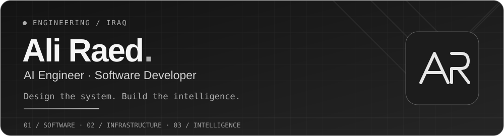

<div align="center">
  
  <br />
  
  <br /><br />
  <a href="https://elsai.space/"></a>
  <a href="https://et-engs.space/"></a>
  <a href="https://t.me/i64vn"></a>
  <a href="https://www.instagram.com/i64vn/"></a>
  <br />
  
  
  
</div>

## 01 / About me

I'm an **AI Engineer and Systems Builder**, currently studying in the Software Department at the University of Babylon, College of Information Technology. My work focuses on AI engineering, LLM-powered products, system design, backend engineering and reliable infrastructure.

I build AI applications and agents, work with prompt engineering and model training, integrate large language models (LLMs), design secure APIs and database architectures, and deploy real-world software products. My technical interests also include network engineering, Linux internals, kernel-level systems and performance. My work on EL.ai brings together AI model integration, Iraqi Arabic experiences, authentication, conversation management and production deployment.

```yaml
role: AI Engineer | Systems Builder
location: Iraq
education: University of Babylon | College of IT | Software Department
focus:
  - AI engineering, agents and LLM-powered applications
  - System design, backend engineering and API development
  - Prompt engineering and model training
  - Network engineering and deployment
  - Databases, authentication and infrastructure
  - Linux internals and kernel-level systems (learning)
  - Arabic and English product experiences
```

## 02 / Selected projects

| Project | What I'm building | Link |
| :--- | :--- | :--- |
| **EL.ai** | Bilingual AI chat platform with Iraqi Arabic experiences, conversation history and model integration. | [Visit EL.ai](https://elsai.space/) |
| **ET Engs** | Bilingual engineering and software services website with a project showcase. | [Visit ET Engs](https://et-engs.space/) |
| **Chipfinder** | Map-based discovery concept for electronics components and local suppliers in Iraq. | [Visit Chipfinder](https://chipfinder.space/) |
| **Study AI** | AI-assisted study workspace with notes, summaries, quizzes and flashcards. | In development |

## 03 / Technology stack

<div align="center">

**Languages**


**Backend & databases**


**AI & Prompt Engineering**


**Infrastructure & developer tools**


</div>

**Additional tools:** Neon · Render · Socket.IO · OpenRouter · Ollama · Google Maps APIs

## 04 / AI & Systems Engineering

<div align="center">
  
  
  
  
  
  
</div>

| Area | Focus |
| :--- | :--- |
| AI engineering | LLM integration, agent orchestration, inference and tool calling |
| System design | Service architecture, scalability, reliability and performance |
| Backend engineering | REST APIs, modular services, real-time applications |
| Prompt engineering | Prompt design, context management and structured outputs |
| Model training | Model training workflows, experimentation and evaluation |
| Data & analytics | Data analysis, relational databases and SQL |
| Application security | Authentication, SSO, sessions and rate limiting |
| Network engineering | Network fundamentals, router configuration and connectivity |
| Deployment | VPS, Linux, Docker, cloud deployment and CI/CD |
| Low-level systems (learning) | Linux internals, operating systems, kernel concepts and performance |

## 05 / Certifications

<div align="center">

**Huawei ICT Academy**


**Google**


</div>

<!-- Subject labels supplied by the profile owner; add exact credential titles and verification links when available. -->

## 06 / GitHub activity

<div align="center">
  <a href="https://github.com/hiihiinnnn-ux?tab=repositories"></a>
  <br /><br />
  
</div>

## AI Engineering Lab / Neural Pipeline

<div align="center">
  
</div>

*Illustrative AI engineering simulation — not live model or contribution telemetry.*

## 07 / Current focus

```yaml
building:
  - EL.ai and AI-powered applications
  - AI agents, model integration and LLM workflows
  - Prompt engineering and model training
  - Network engineering and reliable deployment
  - Reliable backend services and APIs
learning:
  - Scalable architecture and distributed systems
  - Linux internals, kernel concepts and low-level systems
  - Advanced database design and infrastructure
  - AI agents, evaluation and responsible integrations
interested_in:
  - Backend and AI engineering opportunities
  - Software products for Iraq and the wider region
  - Open-source collaboration
```

## 08 / Connect

<div align="center">
  <a href="https://t.me/i64vn"></a>
  <a href="https://github.com/hiihiinnnn-ux"></a>
  <a href="https://www.instagram.com/i64vn/"></a>
  <br />
  <a href="https://elsai.space/">EL.ai</a> · <a href="https://et-engs.space/">ET Engs</a>
  <br /><br />
  <strong>Design the system. Build the intelligence.</strong>
</div>
